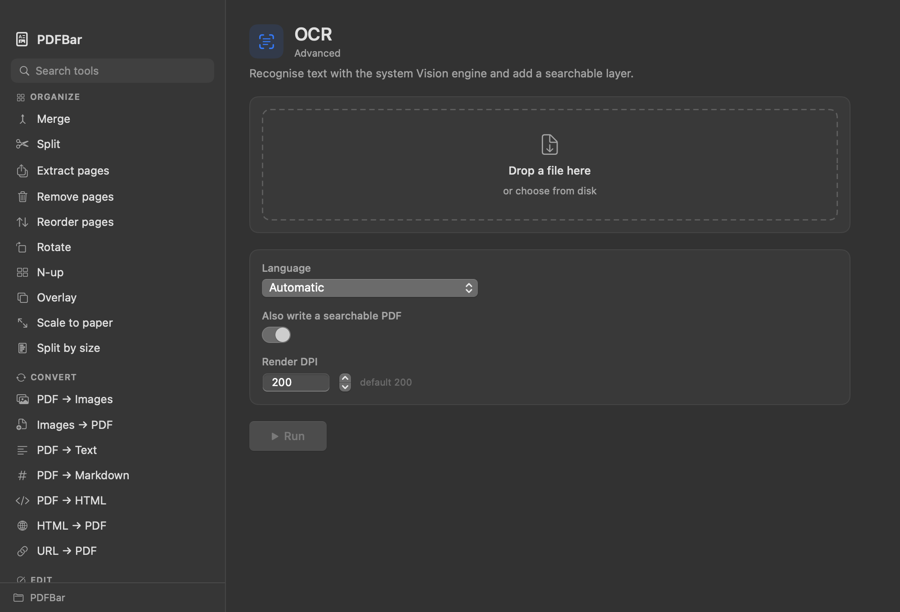

# PDFBar

A macOS menu bar PDF toolkit. Right-click the menu bar icon, pick a tool, done.
Everything runs **locally** — no uploads, no accounts, no network.



## Install

One command, no dependencies (macOS 14+, Apple Silicon **and** Intel):

```bash
curl -fsSL https://raw.githubusercontent.com/hariom-hp/pdfbar/main/install.sh | bash
```

It downloads the prebuilt universal app, installs it to `/Applications`, clears
the quarantine flag, adds a login item, and launches it. `curl`, `ditto` and
`launchctl` ship with macOS, so nothing else is needed.

### Options

```bash
# don't start at login
curl -fsSL .../install.sh | bash -s -- --no-login

# run the built-in self-test after installing
curl -fsSL .../install.sh | bash -s -- --verify

# uninstall
curl -fsSL .../install.sh | bash -s -- --uninstall
```

## Use it

- **Right-click** the menu bar icon → every tool, grouped by category.
- **Left-click** → the full tool browser with search.
- Drop files in, set the options, hit Run. Results go to `~/Downloads/PDFBar`
  (click the folder name in the sidebar to change it).

## Tools

**Organize** — Merge · Split · Extract pages · Remove pages · Reorder pages ·
Rotate · N-up · Overlay · Scale to paper · Split by size

**Convert** — PDF → Images · Images → PDF · PDF → Text · PDF → Markdown ·
PDF → HTML · HTML → PDF · URL → PDF

**Edit** — Watermark · Page numbers · Crop margins · Stamp image · Flatten ·
Redact region · Metadata

**Security** — Add password · Remove password · Sanitize · Repair

**Advanced** — Compress · OCR (Apple Vision) · Inspect · Text diff

That's **32 tools running natively** on PDFKit, CoreGraphics, Vision and WebKit.
No Java, no Docker, no Python, no internet.

Redaction rasterises the covered band, so the text underneath is genuinely
destroyed rather than hidden behind a black rectangle.

## The visual editor

PDFBar's native editing is page-level: watermarks, page numbers, stamps,
metadata, cropping, redaction. It does not let you click into the page and type
over the existing text.

For that, the **Stirling Server → Visual editor** entry opens the full
drag-and-drop editor (add text boxes, images, signatures, then export). It needs
the Stirling-PDF server running locally:

```bash
git clone https://github.com/Stirling-Tools/stirling-pdf
cd stirling-pdf && docker compose up -d
```

The same server powers the other server-backed entries: Office → PDF,
PDF → Word/PowerPoint, PDF/A, and native image extraction — the operations that
genuinely require LibreOffice, Ghostscript or PDFBox. Without the server, PDFBar
still does all 32 native tools offline.

## Build from source

```bash
git clone https://github.com/hariom-hp/pdfbar
cd pdfbar
./install.sh --from-source
```

Requires Xcode Command Line Tools (`xcode-select --install`). The build produces
a universal binary via `swiftc` + `lipo`.

## Development

```bash
./build.sh                                    # universal .app bundle
./.build/release/PDFBar --selftest            # exercise all 29 local operations
./.build/release/PDFBar --dump-menu           # print the right-click menu tree
./.build/release/PDFBar --render-ui watermark /tmp/ui.png   # render window to PNG
```

`--selftest` builds fixtures, runs every operation, and asserts on real outcomes:
page counts, an encrypt → wrong-password-rejected → decrypt round-trip,
text-layer survival, cropBox geometry, and Vision OCR output. It exits non-zero
on any failure.

### Layout

```
Sources/PDFBar/
  main.swift            entry point, single-instance lock, CLI modes
  App.swift             status item, right-click menu, window controller
  Models.swift          Tool / ParamKind / RunContext
  ToolRegistry.swift    the catalogue — every tool and its parameters
  PDFEngine.swift       dispatch, page-range parsing, PDF writing, rasterising
  Tools/                Organize, Convert, Edit, Security, Advanced
  UI/                   AppState + SwiftUI views
```

Adding a tool takes three steps: add a `Tool` to `ToolRegistry`, add a case to
`PDFEngine.run`, and implement it in the matching `Tools/` file.

## Licence

MIT. Stirling-PDF is also MIT; this is an independent front end, not a fork.
